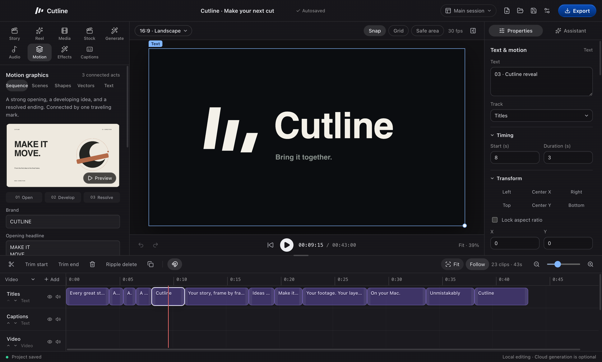

# Cutline

A local video editor for macOS with editable captions, motion graphics, voiceover and optional AI assistance.

[Visit the Cutline website](https://neilbusque.github.io/cutline/) to explore the editor and watch the introduction.

Cutline turns footage, screenshots and scripts into videos you can keep editing. It uses the same composition for preview and MP4 export. Projects are `.cutline` files, and original source media is left unchanged.



**Current build target: macOS 15 or later on Apple Silicon.** Intel Mac, Windows and Linux builds are not supported by the current packaging and bundled binary paths.

## What you can make

- **Shorts and Reels:** edit a speaker video, remove pauses, add word-timed captions, and place real screen evidence in split views or cutaways. [Creator shorts guide](docs/creator-shorts.md).
- **Explainers:** choose Kinetic type, Product focus, Sketch flow or Editorial collage, turn your script into an editable outline, then create local narration, captions and a timeline sequence. [Make an explainer](docs/explainer-guide.md) and [choose a style](docs/explainer-styles.md).
- **Product videos:** plan scenes, use imported screenshots or recordings, add narration, and build an editable sequence. Product layouts and motion scenes render locally.
- **Motion graphics:** animate text, shapes and imported SVG paths with editable layers, keyframes, easing and timing. [Motion controls](docs/motion-controls.md).
- **Voiceover and music:** generate English narration locally with Kokoro, import audio, compose an instrumental bed, and lower music under speech. [Voiceover](docs/kokoro-tts.md) and [music sync](docs/music-sync.md).
- **Assisted editing:** connect Claude or Codex, or use a compatible MCP client to inspect, edit, preview and export the current project. Assistant accounts are optional. [Agent control](docs/agent-control.md).

## Get started

If you already have a trusted Cutline build, open the app and follow [your first edit](docs/getting-started.md). The guide covers importing, captions, voiceover, projects, sessions and exporting.

To build from source, follow [development setup](docs/development.md). The complete setup includes Node dependencies, local speech tools, model files and a pinned full Chrome for Testing application for rendering. Setup downloads that browser locally and verifies its archive and contents. A fresh checkout is not a ready-to-run app bundle.

After installing the prerequisites in that guide:

```sh
npm ci
npm run setup:runtime
npx --no-install install-electron
npm run setup:vendor
npm run setup:speech
npm run build
npm start
```

The current release path is source-only. See the distribution limits below before packaging an application.

## Local work and connected services

Manual editing, transcription, voiceover and export run locally once their tools and models are installed. Initial dependency/model downloads need internet access.

| Optional feature                   | What leaves the Mac                                                                                            |
| ---------------------------------- | -------------------------------------------------------------------------------------------------------------- |
| Claude, Codex or another assistant | Chat messages, requested project details, transcripts, and preview images requested by the assistant           |
| Stock search and download          | Search terms and requests to the selected stock provider; imported assets retain source and license credits    |
| Higgsfield generation              | The submitted prompt and selected reference images; generation uses the connected provider account and credits |

Adding media to a local project does not submit it for cloud generation. Review provider access before using a connected feature. See [security and privacy](SECURITY.md) and [Higgsfield setup](docs/higgsfield.md).

## Documentation

| Task                                 | Guide                                                                                                                     |
| ------------------------------------ | ------------------------------------------------------------------------------------------------------------------------- |
| Make and save a first video          | [Getting started](docs/getting-started.md)                                                                                |
| Choose a Reel structure              | [Reel formats](docs/reel-formats.md)                                                                                      |
| Build speaker and screen-demo Shorts | [Creator shorts](docs/creator-shorts.md)                                                                                  |
| Make a narrated explainer            | [Explainer guide](docs/explainer-guide.md)                                                                                |
| Choose an explainer direction        | [Styles and references](docs/explainer-styles.md)                                                                         |
| Build an educational Reel            | [Creator education](docs/creator-education-style.md)                                                                      |
| Edit motion layers and timing        | [Motion controls](docs/motion-controls.md)                                                                                |
| Create vectors and logo reveals      | [Vector and logo workflow](docs/vector-logo.md)                                                                           |
| Make Jack Roberts, sebintel or Matthew Berman-style Shorts | [Creator-style Shorts](docs/creator-styles.md) |
| Direct a sequence                    | [AI director](docs/ai-director.md)                                                                                        |
| Explore motion collections           | [Studio](docs/studio-motion.md), [professional motion](docs/professional-motion.md), [promo motion](docs/promo-motion.md) |
| Use narration and music              | [Local voiceover](docs/kokoro-tts.md), [music sync](docs/music-sync.md)                                                   |
| Connect an editing assistant         | [Agent control](docs/agent-control.md)                                                                                    |
| Build and test                       | [Development](docs/development.md)                                                                                        |
| Resolve a problem                    | [Troubleshooting](docs/troubleshooting.md)                                                                                |
| Review the current source release    | [Changes in 0.33.1](docs/release-0.33.md)                                                                                 |

## Contribute

Read [CONTRIBUTING.md](CONTRIBUTING.md) before submitting changes. Bug reports should include the app version, macOS version, reproduction steps and sanitized evidence. Use synthetic or licensed sample media rather than private projects. Security reports follow [SECURITY.md](SECURITY.md).

## Licensing and distribution

Cutline's original source code and documentation use the [MIT License](LICENSE). Dependencies keep their own terms, described in [third-party notices](THIRD_PARTY_NOTICES.md) and [source references](licenses/source-notices.md). Remotion is source-available under a custom license. The speech stack includes a phonemizer that embeds GPL-licensed eSpeak NG; it does not share one blanket license.

The currently pinned FFmpeg binary was built with `--enable-nonfree` and is not suitable for redistribution. Do not publish an app bundle, installer or archive containing it. The local packaging override documented in [development](docs/development.md#local-packaging-and-distribution) does not grant redistribution rights.

Access to Cutline's source is not a promise that every dependency permits every use without payment. Review the licenses and notices before distributing anything. App packaging does not sign, notarize or publish a release.
